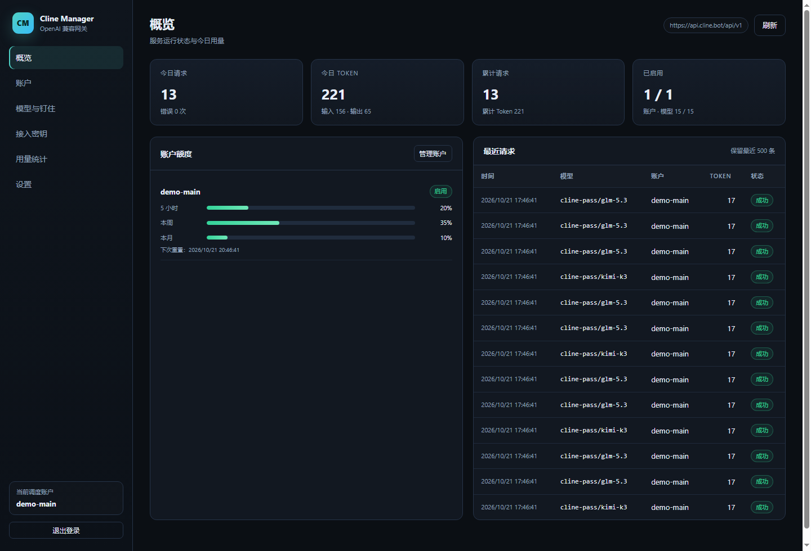
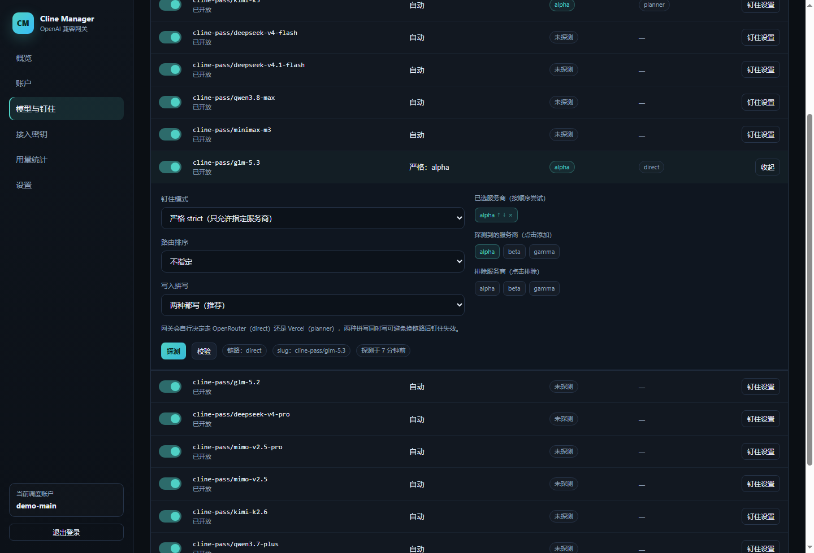
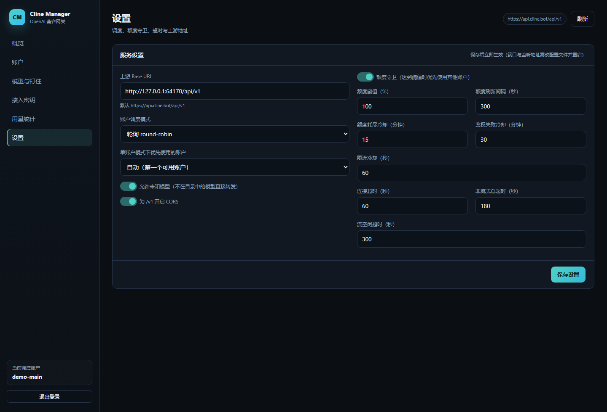
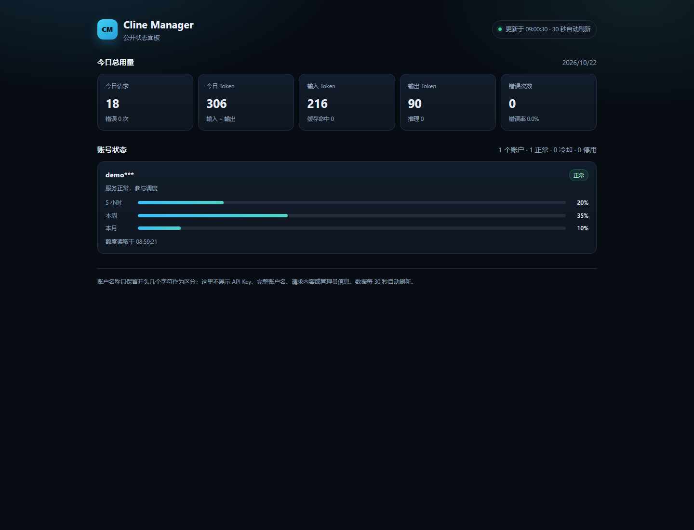

# Cline Manager

[](https://github.com/chengtx007/cline-manager/actions/workflows/docker.yml)
[](https://github.com/chengtx007/cline-manager/pkgs/container/cline-manager)
[](LICENSE)

把 **Cline Pass 订阅**包装成标准 **OpenAI 兼容接口**的独立网关，并提供一个中文管理后台：多账户轮询、额度守卫、故障转移、按模型钉住上游服务商、接入密钥与 token 用量统计。

运行时**零第三方依赖**，只需要 Node.js ≥ 20.3，或者直接用 Docker 镜像。

```
OpenAI 客户端 ──► /v1/chat/completions ──► 账户池（轮询 / 单账户）
                                              │  额度守卫 · 冷却 · 并发槽
                                              ▼
                                     Cline Pass 网关
                                     api.cline.bot/api/v1
                                              │
                              ┌───────────────┴───────────────┐
                              ▼                               ▼
                    direct（OpenRouter）              planner（Vercel AI Gateway）
                    provider.only/order             providerOptions.gateway.only/order
```

> 本项目是对 [`dsh-cline-pass`](https://github.com/yhshzh/dsh-cline-pass) 与 [`cline-pass-switcher`](https://github.com/munmunjaklin458-afk/cline-pass-switcher) 所记录的 Cline Pass 行为的独立服务化实现，不是 Cline 官方项目。

## 界面





## 功能特性

- **OpenAI 兼容**：`POST /v1/chat/completions`（支持 SSE 流式）、`GET /v1/models`、`GET /v1/models/{id}`。
- **多账户池**：`roundrobin` 每个请求换一个账户；`single` 固定优先账户；每个账户独立并发上限。
- **额度守卫与自动切换**：定期读取 Cline 官方额度；在首个 token 前遇到 401/403、402、额度耗尽或 429 时，立即换账户并让失败的账户进入冷却。
- **按模型钉住服务商**：配置服务商顺序、`strict` / `preferred` 模式、`cost/ttft/tps` 排序和排除列表；支持自动探测服务商、逐渠道校验，以及「测试钉住」按当前规则发一次真实请求并回读实际服务商。
- **双拼写注入**：同时写 OpenRouter（`provider.*`）和 Vercel AI Gateway（`providerOptions.gateway.*`）两种字段，避免网关切换链路后钉住悄悄失效。
- **接入密钥**：后台创建/停用/删除网关自己的 `sk-cline-...` Key，客户端用 `Authorization: Bearer` 或 `x-api-key` 调用。
- **模型开关**：关闭的模型不会出现在 `/v1/models`，请求会返回 `model_not_found`。
- **用量统计**：本地按天、模型、账户、接入 Key 统计请求数与输入/输出/缓存/推理 token；账户详情还能拉取 Cline 官方的 30 天逐日逐模型用量和费用。
- **中文管理后台**：单页 Web UI，包含概览、账户、模型与钉住、接入密钥、设置；首页把今日概览、账户额度和 1/7/30/90 天用量统计合并在一起。
- **可选公开展示页**：开启后 `/public` 无需令牌即可查看打码后的账户状态和今日用量。
- **Docker 镜像**：GitHub Actions 自动构建多架构镜像并发布到 GHCR，可直接 `docker pull`。

## 快速开始

### 方式一：直接拉取镜像（推荐）

镜像发布在 GitHub Container Registry，公开可拉取，支持 `linux/amd64` 与 `linux/arm64`：

```bash
docker pull ghcr.io/chengtx007/cline-manager:latest

docker run -d --name cline-manager \
  --restart unless-stopped \
  -p 127.0.0.1:8787:8787 \
  -v cline-manager-data:/data \
  ghcr.io/chengtx007/cline-manager:latest

docker logs cline-manager
```

首次启动会打印管理员令牌和第一个接入 Key（**只显示这一次**）：

```
  Cline Manager 已启动
  管理后台:   http://127.0.0.1:8787/admin
  OpenAI 兼容: http://127.0.0.1:8787/v1
  管理员令牌（仅本次显示，已写入 /data/config.json）:
    atk-...
  已生成第一个接入 API Key（仅本次显示，请立即保存）:
    sk-cline-...
```

打开 `http://127.0.0.1:8787/admin`，用管理员令牌登录。

### 方式二：Docker Compose

仓库自带 [`docker-compose.yml`](docker-compose.yml)：

```bash
docker compose up -d          # 优先使用已发布的镜像
docker compose logs -f cline-manager
```

想从本机源码构建：

```bash
docker compose up -d --build
```

Compose 默认只绑定 `127.0.0.1:8787`（安全默认值）；需要局域网访问时把 `ports` 改成 `"8787:8787"`，并自行加 HTTPS 或反向代理。

### 方式三：源码运行

```bash
# Node.js >= 20.3
node server.js

# 或开发模式（文件变更自动重启）
npm run dev
```

数据默认写到当前目录的 `./data`，可以用 `DATA_DIR` 指定。

无论哪种方式，首次启动都会在数据目录生成 `config.json`，其中保存管理员令牌、接入 Key 的哈希和账户配置。

### 开始使用

1. 打开管理后台，用管理员令牌登录。
2. 在「账户」里添加一个或多个 Cline Pass API Key，点「测试」确认可用。
3. 在「接入密钥」里为每个客户端创建 Key。
4. 把 OpenAI 客户端的 base URL 指向 `http://<host>:8787/v1`，Key 用上一步生成的 `sk-cline-...`。

## 客户端接入

```bash
curl http://127.0.0.1:8787/v1/chat/completions \
  -H "Authorization: Bearer sk-cline-..." \
  -H "Content-Type: application/json" \
  -d '{
    "model": "cline-pass/glm-5.3",
    "messages": [{"role": "user", "content": "你好"}],
    "stream": true
  }'
```

Python（OpenAI SDK）：

```python
from openai import OpenAI

client = OpenAI(base_url="http://127.0.0.1:8787/v1", api_key="sk-cline-...")
resp = client.chat.completions.create(
    model="cline-pass/glm-5.3",
    messages=[{"role": "user", "content": "你好"}],
)
print(resp.choices[0].message.content)
```

Node.js（OpenAI SDK）：

```js
import OpenAI from 'openai'

const client = new OpenAI({ baseURL: 'http://127.0.0.1:8787/v1', apiKey: 'sk-cline-...' })
const resp = await client.chat.completions.create({
  model: 'cline-pass/glm-5.3',
  messages: [{ role: 'user', content: '你好' }],
})
console.log(resp.choices[0].message.content)
```

模型 ID 可以写完整 `cline-pass/glm-5.3`，也可以只写 `glm-5.3`；网关会自动映射到已启用的完整 ID。未知模型默认允许透传，可在「设置」里关闭。

## 环境变量

| 变量 | 默认值 | 说明 |
|---|---|---|
| `PORT` | `8787` | 监听端口 |
| `HOST` | `0.0.0.0` | 监听地址；只给本机反向代理使用时建议 `127.0.0.1` |
| `DATA_DIR` | `./data` | `config.json` / `stats.json` 所在目录；容器内为 `/data` |
| `ADMIN_TOKEN` | 自动生成 | 覆盖管理员令牌；不设置则读写配置文件中的值 |
| `GATEWAY_API_KEY` | 自动生成 | 首次启动时用这个固定值创建接入 Key；之后不再生效 |
| `CLINE_BASE_URL` | `https://api.cline.bot/api/v1` | 上游地址 |
| `CLINE_RECOMMENDED_URL` | `https://api.cline.bot/api/v1/ai/cline/recommended-models` | 公开模型目录 |

Node ≥ 20.6 可以用 `node --env-file=.env server.js` 读取 `.env`。

## 管理后台

- **概览 / 用量统计**：今日请求/token/错误、累计用量、各账户额度条、最近请求，以及 1/7/30/90 天切换的每日堆叠图、按模型/接入 Key/账户汇总和请求明细，全部在同一首页。
- **账户**：添加/编辑/删除 Cline Key；测试鉴权；刷新官方额度；查看 30 天逐日逐模型用量和费用；查看冷却状态。
- **模型与钉住**：开关模型；展开行后：
  - **探测**：发三次小请求，识别当前走哪条链路、当前由哪个服务商服务，并让路由器用「不存在的服务商」报错，从而列出全部候选服务商。**探测请求不带钉住**，所以「最近服务商」列可以是任意一个，不能说明钉住是否生效。
  - **钉住**：点击服务商加入顺序列表，可上移/下移；选择 `strict`（只允许列表内）或 `preferred`（按顺序回退）；可设置排序指标 `cost/ttft/tps`；可点击排除服务商。
  - **校验**：对每个服务商发一次严格的微型请求，并回读响应里的实际服务商，确认钉住是否真的生效。
  - **测试钉住**：按当前保存的钉住规则（含模式、顺序、排序、排除）发一次真实请求，回读实际服务商和使用的账户；行内会显示「钉住已生效 / 钉住未生效」。线上请求如果被路由到别的服务商，也会在行内标出。
- **接入密钥**：创建（完整 Key 只显示一次）、停用、启用、删除。
- **设置**：上游地址、轮询/单账户、优先账户、额度守卫阈值与刷新间隔、冷却时间、超时，以及公开展示页开关。



## 公开展示页（可选）

在「设置」里勾选「开启公开展示页」后，任何人都可以访问：

```
http://<host>:8787/public
```

无需管理员令牌。适合把账号健康度和今日用量分享给朋友或团队，也方便嵌入其他页面。

公开页只展示：

- **今日总用量**：请求数、错误数、输入/输出/合计 token、缓存与推理 token
- **账户状态**：打码后的名称（只保留开头几个字符，例如 `自***`）、正常/冷却/停用状态、5 小时/本周/本月额度百分比

不会展示：API Key、完整账户名、账户 ID、上游 Base URL、请求内容、请求历史、模型或接入 Key 明细。页面每 30 秒自动刷新，只读。

关闭开关后，`/public` 与 `/public/api/state` 都返回 404。该开关默认关闭。



## 钉住是怎么实现的

Cline Pass 背后有两条路由链路，它们认的字段不一样：

| 链路 | 钉住字段 |
|---|---|
| direct（OpenRouter） | 顶层 `provider.only` / `order` / `sort` / `ignore` |
| planner（Vercel AI Gateway） | `providerOptions.gateway.only` / `order` / `sort` |

网关默认**同时写入两种拼写**。每条链路只认自己那一份，所以同时写是安全的；而只写探测到的那一份，会在网关换链路时让钉住悄悄失效。

排除列表会被编译成 `only` 允许列表（因为网关忽略 `exclude` 类字段），同时给 direct 链路额外写 `provider.ignore` 作为兜底。没有服务商列表时无法编译允许列表，后台会给出警告，此时请先「探测」。

钉住是否生效不是看 HTTP 200，而是看响应里报告的实际服务商：

- direct：响应顶层 `provider`
- planner：`choices[0].message.provider_metadata.gateway.routing.finalProvider`

「校验」「测试钉住」与探测都是基于这个字段判断的。测试钉住会按已保存的钉住配置发真实请求；探测则故意不带钉住，只用于发现渠道。

钉住是**按模型**保存的池级配置，不是按账户保存：所有账户共用同一套服务商规则。如果多个账户来自同一上游、同一套餐，规则基本等效；如果某个账户的网关/套餐/地区不同，它可能不认某个 `only` 值，此时请求仍会成功，但会回落到别的服务商。

## 额度与自动切换

1. 网关每 5 分钟（可配置）读取一次每个启用账户的 `GET /users/me/plan/usage-limits`，得到 `five_hour / weekly / monthly` 三个窗口的百分比。
2. 请求进来时，达到额度阈值（默认 100%）的账户会排在健康账户之后；只有全部账户都不可用时才会尝试。
3. 上游返回 401/403、402、明确的额度耗尽文案，或 429 时：
   - 该账户立即从本次请求中排除；
   - 记入冷却（额度默认 15 分钟、鉴权默认 30 分钟、限流默认 60 秒，额度冷却会尽量延长到重置时间）；
   - 下一个账户从第一条钉住候选重新开始。
4. 只有在**首个 token 输出前**才会切换。一旦内容已经发给客户端，后续错误会作为该回答的错误返回，不会重试。

如果 Cline 的额度接口暂时不可用，额度守卫会跳过预检，但运行时遇到 402 仍然会切换账户。

## Token 统计口径

- 流式请求会强制向上游带 `stream_options.include_usage = true`，从最后一帧 `usage` 读取。
- 非流式直接读取响应里的 `usage`。
- 统计项：`prompt_tokens`（输入）、`completion_tokens`（输出）、`total_tokens`、`cached_tokens`、`reasoning_tokens`。
- 本地统计按天保存到 `data/stats.json`，保留 400 天；最近 500 条请求明细保存在同一文件。
- Cline 官方额度与逐日用量与本地统计是两套口径：官方接口按账户的计费口径汇总，本地统计按经过网关的请求汇总。账户详情里会同时展示两者。

## Docker 镜像与 GitHub Actions

镜像仓库：`ghcr.io/chengtx007/cline-manager`

| 标签 | 含义 |
|---|---|
| `latest` | `main` 分支最新构建 |
| `main` | `main` 分支最新构建 |
| `v1.0.0`、`1.0` | 推送 `v*` tag 时生成的语义化版本 |
| `sha-xxxxxxx` | 某次提交的短 SHA |

- 工作流：[`.github/workflows/docker.yml`](.github/workflows/docker.yml)
- 触发：推送到 `main`、推送 `v*` 标签、PR、手动 `workflow_dispatch`
- 流程：先跑 16 项端到端测试和 7 项 UI 测试，再构建 `linux/amd64` + `linux/arm64` 多架构镜像并推送到 GHCR
- PR 只构建 `linux/amd64` 且不推送

发布一个新版本：

```bash
git tag v1.0.0
git push origin v1.0.0
```

更新已部署的容器：

```bash
docker pull ghcr.io/chengtx007/cline-manager:latest
docker compose up -d
```

### 本地构建与部署

```bash
# 构建
docker build -t cline-manager .

# 运行
docker run -d --name cline-manager \
  --restart unless-stopped \
  -p 8787:8787 \
  -v cline-manager-data:/data \
  cline-manager

# 或者用 Compose 从源码构建
docker compose up -d --build
```

容器以非 root 用户 `node` 运行，数据放在 `/data` 卷。使用 bind mount 时，需要保证宿主机目录可写（`chown 1000:1000`）；使用命名卷则会自动继承镜像里的权限。

镜像内置健康检查：`GET /health`。

## systemd 部署（不用 Docker）

仓库提供 [`deploy/cline-manager.service`](deploy/cline-manager.service)：

```bash
sudo cp deploy/cline-manager.service /etc/systemd/system/
sudo useradd --system --home /opt/cline-manager --shell /usr/sbin/nologin cline
sudo mkdir -p /opt/cline-manager /var/lib/cline-manager
sudo cp -r ./* /opt/cline-manager/
sudo chown -R cline:cline /opt/cline-manager /var/lib/cline-manager
sudo systemctl daemon-reload
sudo systemctl enable --now cline-manager
sudo journalctl -u cline-manager -f   # 首次启动在这里看令牌
```

## Nginx 反向代理（SSE 必须关闭缓冲）

```nginx
server {
    listen 443 ssl http2;
    server_name cline.example.com;

    location / {
        proxy_pass http://127.0.0.1:8787;
        proxy_http_version 1.1;
        proxy_set_header Host $host;
        proxy_set_header X-Real-IP $remote_addr;
        proxy_set_header X-Forwarded-For $proxy_add_x_forwarded_for;
        proxy_set_header X-Forwarded-Proto $scheme;

        # 流式输出
        proxy_buffering off;
        proxy_cache off;
        proxy_read_timeout 3600s;
        proxy_send_timeout 3600s;
    }
}
```

建议在反向代理层加 HTTPS、访问控制和请求体大小限制。管理后台与 `/v1` 共用一个端口；如果只想暴露 OpenAI 兼容接口，可以在 Nginx 里只放行 `/v1/`、`/healthz`。开启公开展示页时再额外放行 `/public`。

## 安全说明

- Cline API Key 以明文保存在 `data/config.json`（上游请求必须用到），文件权限会尽力设为 `0600`；请确保备份与目录权限安全。
- 接入 Key 只保存 SHA-256 哈希和掩码提示，创建后无法再次查看完整值。
- 管理员令牌通过 `Authorization: Bearer` 或 `x-admin-token` 传递，不落 cookie。
- 默认监听 `0.0.0.0:8787`。如果前面有反向代理，建议改成 `HOST=127.0.0.1`，并只开放代理端口；Compose 默认只绑定 `127.0.0.1`。
- 网关自身没有 TLS；公网部署请务必套 HTTPS。
- Docker 镜像以非 root 身份运行，只暴露 8787 端口，数据目录独立挂载。
- 公开展示页一旦开启就无需认证；它只包含打码账户名、状态和今日汇总，但请把它视为对外公开的数据，不要在账户命名里写敏感信息。关闭后立即返回 404。

## 目录结构

```
server.js                    CLI 入口
src/app.js                   HTTP 路由、静态文件、生命周期
src/store.js                 配置加载/校验/原子持久化
src/cline.js                 Cline 传输层与额度/用量接口
src/protocol.js              钉住注入、链路解析、错误分类
src/pool.js                  账户选择、冷却、并发槽
src/usage.js                 额度缓存与定时刷新
src/models.js                模型目录、探测、校验、路由学习
src/proxy.js                 OpenAI 兼容代理与 SSE 转发
src/stats.js                 本地 token 统计
src/admin.js                 管理 API
public/                      管理后台单页 + 公开展示页（share.html/share.js/share.css）
test/                        mock 上游、端到端测试、UI 测试
deploy/cline-manager.service systemd 单元文件
Dockerfile                   多阶段运行时镜像（Node 22 alpine，非 root）
docker-compose.yml           本地/服务器部署
.github/workflows/docker.yml 测试 + 多架构镜像构建与 GHCR 发布
docs/screenshots/            README 截图
data/                        运行时生成
```

## HTTP 接口

| 方法 | 路径 | 说明 |
|---|---|---|
| POST | `/v1/chat/completions` | OpenAI 兼容聊天补全（流式/非流式） |
| GET | `/v1/models` | 已开启的模型列表 |
| GET | `/v1/models/{id}` | 单个模型 |
| GET | `/healthz`、`/health` | 健康检查 |
| GET | `/admin` | 管理后台 |
| GET | `/admin/api/state` | 后台全量状态 |
| POST/PATCH/DELETE | `/admin/api/accounts...` | 账户管理、测试、额度刷新 |
| GET/POST/PATCH/DELETE | `/admin/api/keys...` | 接入 Key 管理 |
| GET/POST/PATCH/DELETE | `/admin/api/models...` | 模型开关、钉住、探测、校验 |
| PATCH | `/admin/api/settings` | 调度/额度/冷却/超时设置 |
| GET | `/admin/api/stats?days=7` | 统计汇总 |
| GET | `/admin/api/logs?limit=100` | 最近请求 |
| GET | `/public` | 公开展示页（设置里开启后） |
| GET | `/public/api/state` | 公开只读状态：打码账户、今日汇总（开启后免令牌） |

## 测试

```bash
npm test        # 端到端：鉴权、额度、流式、双链路钉住、测试钉住、探测、校验、公开展示页、自动切换、密钥、重启持久化
npm install     # 安装 jsdom（仅 UI 测试需要）
npm run test:ui # 用 jsdom 实际渲染并点击管理后台
npm run test:all
```

测试使用本地 mock 上游，不会访问真实 Cline，也不消耗额度。

## 说明与限制

- 本项目是独立服务化实现，不是 Cline 官方项目。
- Cline 的上游协议和额度接口可能变化。遇到 4xx/5xx 时，后台「请求明细」会保留上游返回的错误文本，便于排查。
- 服务商名称存在两种拼写（例如 `zai` 与 `z-ai`），钉住注入时已做映射；探测结果以实际链路返回为准，且探测请求本身不带钉住，确认钉住请用「测试钉住」。
- 流式请求在首个内容帧之前会短暂缓冲，这是为了保留换账户/换渠道的能力；首个 token 的延迟会略高于直连。
- 钉住是池级、按模型的配置，不支持为不同账户设置不同的服务商规则。

## 致谢

- [dsh-cline-pass](https://github.com/yhshzh/dsh-cline-pass)（MIT）：Cline Pass 传输、额度接口、链路探测与钉住语义。
- [cline-pass-switcher](https://github.com/munmunjaklin458-afk/cline-pass-switcher)（MIT）：服务商列表与故障转移 findings。
- [LinuxDo](https://linux.do/)：社区支持。

## License

[MIT](LICENSE)
